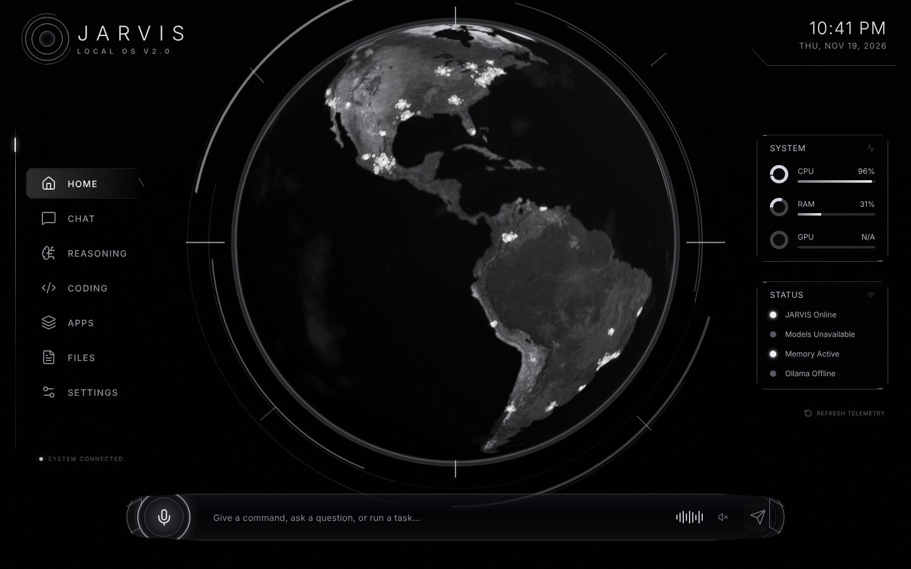
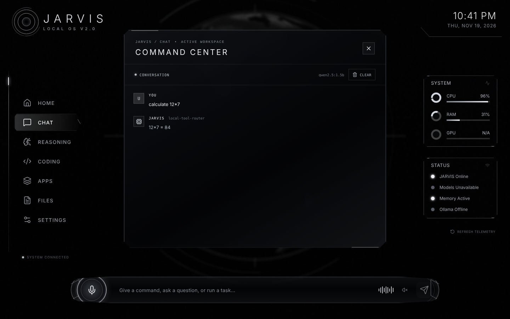
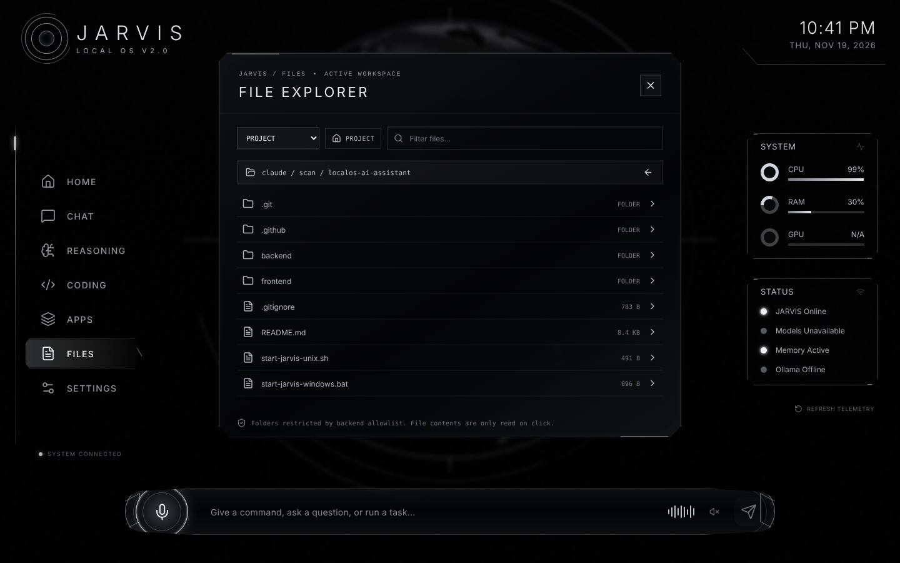

# JARVIS — Local OS V2.0

A working monochrome, sci-fi desktop AI assistant built **on top of the original LocalOS AI Assistant project**. The dashboard reproduces the layout and design language of the supplied JARVIS reference: rotating photographic Earth, animated targeting rings, left navigation, live telemetry, status lights, a bottom voice/command dock, and the JARVIS clock and identity.

The assistant is local-first, not a static screenshot. The original FastAPI + Ollama chat and safe tool router are preserved, with new endpoints and functional React workspaces.

## Screenshots

**Home: live system telemetry and local model status**



**Command center: tool router answering locally**



**File explorer restricted to an allowlist of folders**



## Features

| Screen | Working behavior |
|---|---|
| Home | Draggable/zoomable 3D Earth with silver Blue Marble map, city lights, clouds, rotating HUD rings, command bar |
| Chat | Local Ollama chat, live response state, persistent history, response copy, clear history |
| Reasoning | Uses the reasoning mode model or an installed fallback |
| Coding | Uses the coding model or an installed coding fallback |
| Apps | Launch configured installed desktop apps; open allowed websites |
| Notes | Create/list notes stored locally |
| Memory | Save facts and reuse them as chat context |
| Files | Browse allowlisted local folders, filter names, explicitly open text previews |
| Settings | Model override, voice toggle, user profile, model/backend diagnostics, history clearing |
| System | Live CPU/RAM and (where `nvidia-smi` is available) GPU usage. Unavailable metrics show **N/A**. |
| Status | Actual backend/Ollama/model status rather than placeholder percentage/online flags |
| Voice | Browser SpeechRecognition dictation on supported browsers, backend speech responses with offline `pyttsx3` fallback |

## Requirements

- Node.js **22+** and npm
- Python **3.11+** and pip
- [Ollama](https://ollama.com/) for real local AI replies (running on `127.0.0.1:11434`)
- Chrome/Edge for the best microphone browser support, or Electron for a desktop window (speech recognition availability varies by Chromium build)
- Optional NVIDIA drivers + `nvidia-smi` to display GPU utilization

A locally installed Ollama model is necessary for AI responses. For example:

```bash
ollama pull qwen2.5:1.5b
ollama serve
```

If Ollama is already running as a service, don't start a second server. The backend detects installed models and falls back to one you have installed when the mode's default isn't present. Coding works best with `ollama pull qwen2.5-coder:7b` (larger download).

## Easiest desktop setup

On **Windows**, double-click `start-jarvis-windows.bat`. On **macOS or Linux**, run `./start-jarvis-unix.sh` in a terminal.

These scripts create a Python virtual environment, install backend + frontend dependencies if needed, and open the Electron application. They **do not install Ollama or download an AI model for you**; install and start Ollama first.

## Manual development setup

**Terminal 1 — backend:**

```bash
cd backend
python -m venv venv
# Windows: venv\Scripts\activate
# macOS/Linux: source venv/bin/activate
pip install -r requirements.txt
python -m uvicorn main:app --host 127.0.0.1 --port 8000 --reload
```

**Terminal 2 — frontend:**

```bash
cd frontend
npm ci
npm run dev
```

Open `http://127.0.0.1:5173`. For the Electron desktop shell, run `npm run electron:dev` from `frontend` rather than `npm run dev` (Electron starts the backend automatically if its port is free).

To validate the frontend after dependency installation:

```bash
cd frontend
npm run typecheck
npm run build
```

To run backend API contract tests:

```bash
cd backend
pip install -r requirements-dev.txt   # adds httpx for the FastAPI test client
python -m unittest discover -s tests -v
```

GitHub Actions runs these tests and the frontend build on every push (`.github/workflows/ci.yml`).

## Backend API endpoints

Original endpoints are preserved: `GET /startup`, `POST /chat`, `POST /tool`, `POST /speak`, `POST /stop-speech`, and legacy wake endpoints. New endpoints include:

- `GET /api/status`, `GET /api/system`, `GET /api/models`
- `GET /api/history`, `DELETE /api/history`
- `GET /api/profile`, `PATCH /api/profile`
- `GET /api/memory`, `POST /api/memory`
- `GET /api/notes`, `POST /api/notes`
- `GET /api/locations`, `GET /api/files`, `GET /api/files/read`
- `GET /api/apps`, `POST /api/apps/launch`

Swagger at `http://127.0.0.1:8000/docs`. Every endpoint except `/` and the docs needs the `X-Jarvis-Token` header (see Security below); paste the token from `backend/data/.jarvis_token` to try calls there.

Files, notes, memory and chat history are local. The file explorer is restricted by `backend/permissions.py`; reading file contents requires an explicit click. The server is intentionally bound to loopback (`127.0.0.1`) and every request must carry the session token. Still, do not expose it on a public network. `LOCALOS_DATA_DIR` lets you set the location of local user data; default `backend/data`, which is Git-ignored. `OLLAMA_BASE_URL` optionally points to another local Ollama endpoint.

## Security

**The issue I found.** Binding to `127.0.0.1` does not keep other websites out: any page open in your browser can send requests to `localhost`. Version 1 allowed every CORS origin. Version 2 narrowed the list but still had to allow `Origin: null`, which the packaged Electron app sends from `file://`. A sandboxed iframe on *any* website also sends `Origin: null`. In testing, a page served from a different origin used that trick to read a file from `~/Documents` through `/api/files/read`, and to write a file through `/tool` (`write_file_request` followed by `confirm_action`, since the confirmation ID comes back in the response).

**The fix: a per-install session token.**

- On first start the backend creates a random 256-bit token in `backend/data/.jarvis_token` (owner-only permissions, Git-ignored), or uses `JARVIS_TOKEN` if set. Code: `backend/security.py`.
- Middleware rejects every request without a matching `X-Jarvis-Token` header with **401**, compared in constant time. Only `/`, the API docs and CORS preflights are open.
- **Electron** generates or reads the token, passes it to the backend it starts, and hands it to the page through a sandboxed preload (`frontend/electron/preload.cjs`). It only answers requests from the JARVIS frontend itself.
- **Browser dev mode** (`npm run dev`): the Vite dev server reads the token file and puts it in a `<meta>` tag of the page it serves. Other websites cannot read that page, so they never see the token. Start the backend first, or refresh after starting it.
- The same token also blocks DNS-rebinding attacks, because the attacker's page never learns it.

Tests in `backend/tests/test_api.py` cover the missing-token, wrong-token and `Origin: null` cases.

## Packaging caveat

`cd frontend && npm run dist:win` creates an Electron installer and includes the Python backend *source*, not an embedded standalone Python interpreter or Ollama runtime. The destination machine still needs a working Python installation, backend Python packages, and Ollama + model. For a truly self-contained Windows installer, a separate Python executable bundling step is needed.

## Assets & authorship

The Earth surface was derived from the **NASA Blue Marble Next Generation imagery** distributed with Basemap; the local city-light layer and monochrome conversion were created for this project. Local assets live under `frontend/public/textures` and do not need network access during rendering. The HUD visuals use CSS and Three.js geometry.

Original LocalOS AI Assistant project by **Shreya Lanka**; this V2.0 is a redesign and extension of that codebase. Existing project files and legacy endpoints remain available.

## Limitations / verification

- Live AI requires an installed, running Ollama model. No cloud model or hosted backend is secretly substituted.
- Voice dictation support depends on browser/electron speech permissions and engines; offline speech *output* uses pyttsx3 when installed. Browser speech recognition may itself use online services depending on the platform.
- Real GPU telemetry is supported via `nvidia-smi`; on unsupported hardware the dashboard shows `N/A`.
- The local frontend dependencies could not be downloaded in the environment where the code was prepared. Backend API contract tests passed and TSX sources were syntax-checked, but **a final React build and visual comparison must be run after `npm ci` on a network-connected machine**. Thus pixel-perfect similarity and end-to-end model/voice behavior have not been verified on your computer.
